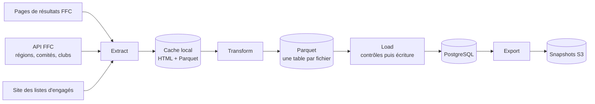
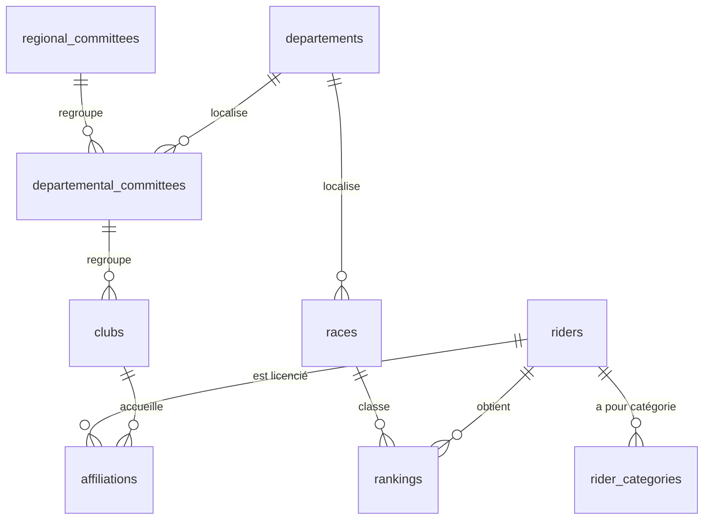

# Access it!

Projet personnel de prévision des résultats des courses cyclistes amateurs françaises
de la catégorie **Access** (Access 1 à Access 4, Fédération française de cyclisme),
pour les régions **Bretagne** et **Pays de la Loire**.

Le projet couvre toute la chaîne d'un projet de données : collecte (scraping et API),
ETL, base de données, puis, à venir, analyse exploratoire, modèles de machine learning,
API et tableau de bord.

## État d'avancement

| Étape | État |
|---|---|
| Collecte des données et ETL (extract, transform, load) | fonctionnel |
| Base PostgreSQL et snapshots S3 | fonctionnel |
| Exécution programmée de l'ETL | à venir |
| Analyse exploratoire et modèles (scikit-learn, XGBoost, MLflow) | à venir |
| API (FastAPI) et tableau de bord (Streamlit) sur Hugging Face Spaces | à venir |

## Architecture



### Sources

- **Pages de résultats de la FFC** : courses sur route des catégories Access. La saison en
  cours est trouvée par le moteur de recherche du site, par département ; les saisons
  terminées sont aussi interrogées par numéro d'épreuve.
- **API de la FFC** : régions, comités régionaux et départementaux, clubs.
- **Site des listes d'engagés** : catégorie Access de chaque coureur engagé, utilisée pour
  préciser les catégories (adresse définie par la variable `STARTLISTS_URL`).

### Étapes de l'ETL

1. **Extract** (`scripts/extract.py`) : télécharge les pages et les met en cache. Une page
   déjà en cache n'est jamais redemandée. Les requêtes sont espacées d'un délai minimal par
   site, et une page en échec est réessayée à l'exécution suivante. Les pages de résultats
   des autres régions (depuis la saison 2026) sont aussi téléchargées, dans un dossier à
   part : elles servent uniquement à trouver le comité des licenciés individuels.
2. **Transform** (`scripts/transform.py`) : analyse les pages en cache, identifie les clubs
   et les coureurs, corrige les erreurs connues des sources, calcule les affiliations et
   l'historique des catégories, puis écrit un fichier Parquet par table.
3. **Load** (`scripts/load.py`) : contrôle les fichiers (clés, clés étrangères, volumes,
   lignes disparues) avant toute écriture, puis met à jour la base en une seule transaction,
   en n'écrivant que les lignes nouvelles ou modifiées.

### Tables



| Table | Contenu | Clé |
|---|---|---|
| `races` | une course par classement Access d'une épreuve | `race_id` |
| `rankings` | résultat d'un coureur dans une course (ex æquo possibles) | `race_id`, `rider_id` |
| `riders` | coureurs, identifiés par leur UCI ID quand il est valide | `rider_id` |
| `clubs` | clubs (numéro FFC à 7 chiffres) et leurs noms alternatifs | `club_id` |
| `affiliations` | périodes d'appartenance d'un coureur à un club, sans chevauchement | `rider_id`, `start_date` |
| `rider_categories` | périodes de catégorie Access d'un coureur (catégorie inconnue possible) | `rider_id`, `start_date` |
| `departements`, `regional_committees`, `departemental_committees` | référentiels de la FFC | identifiants FFC |

Les tables `affiliations` et `rider_categories` n'ont pas de date de fin : une période se
termine la veille de la période suivante du même coureur, ou est toujours en cours.

## Installation

Python 3.12 ou plus récent est requis. Depuis la racine du dépôt :

```bash
python -m venv .venv
source .venv/bin/activate
pip install -e ".[dev]"
```

## Configuration

Les variables d'environnement sont lues dans un fichier `.env` à la racine du dépôt (jamais
versionné). Toutes sont obligatoires.

| Variable | Rôle |
|---|---|
| `DATABASE_URL` | URL SQLAlchemy de la base PostgreSQL (`postgresql+psycopg://...`) |
| `AWS_ENDPOINT_URL_S3` | adresse du stockage S3 des snapshots |
| `AWS_ACCESS_KEY_ID` | clé d'accès du stockage S3 |
| `AWS_SECRET_ACCESS_KEY` | clé secrète du stockage S3 |
| `AWS_REGION` | région du stockage S3 |
| `S3_BUCKET` | bucket des snapshots |
| `STARTLISTS_URL` | adresse du site des listes d'engagés |
| `SQL_INFO` | facultative : `true` pour afficher les requêtes SQL |
| `ACCESS_IT_CACHE` | facultative : dossier du cache (par défaut `~/.access-it/cache`) |

Une base PostgreSQL locale peut être lancée avec Docker pour les essais (voir
`local_db_dev/README.md`) :

```bash
docker compose -f local_db_dev/compose.yaml up -d
```

## Utilisation

Toutes les commandes se lancent depuis la racine du dépôt.

| Commande | Effet |
|---|---|
| `python scripts/etl.py` | ETL complet : extract, transform, puis load |
| `python scripts/extract.py` | téléchargement des pages et des référentiels |
| `python scripts/transform.py` | construction des tables (fichiers Parquet) |
| `python scripts/load.py` | contrôles, puis écriture dans la base |
| `python scripts/export_database_to_s3_bucket.py` | snapshot de la base sur S3 (10 conservés) |
| `python scripts/check_startlist_matches.py` | contrôle des identifications de secours des listes d'engagés (lecture seule) |
| `python scripts/prune_stale_rows.py` | simulation du nettoyage des coureurs obsolètes ; `--apply` pour supprimer |
| `python -m access_it.etl.load.schema {create,drop,reset}` | création, suppression ou réinitialisation des tables |

Ne lancez pas le load après un extract seul : l'extract remplace les fichiers Parquet des
clubs et des référentiels, que seul le transform complète. La
[procédure d'exploitation](docs/exploitation.md) décrit les messages de l'ETL, les contrôles
bloquants et le nettoyage de la base.

## Tests

```bash
python -m pytest tests -q -m "not regression"
```

Le test de non-régression du transform compare les sorties du code à une référence, à
partir d'entrées figées (dossier `~/.access-it/regression`) :

```bash
python tests/regression/transform_regression.py freeze      # fige les entrées actuelles
python tests/regression/transform_regression.py baseline    # crée la référence
python tests/regression/transform_regression.py compare     # compare le code actuel à la référence
```

La référence est à régénérer (`baseline --overwrite`) après chaque changement volontaire des
sorties du transform.

## Licence

MIT (voir `LICENSE`).
